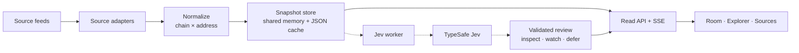

# CrawlCA

Contract address intelligence for fragmented on-chain markets.

CrawlCA connects launchpads, exchanges, and market feeds into one inspectable workspace. Every record keeps its chain and address, the source it came from, and the time it was observed. The browser reads that evidence. A separate review path turns a completed snapshot into a bounded next step: **inspect**, **watch**, or **defer**.

<p align="center">
  
</p>

## Surfaces

| | | |
|---|---|---|
| **Room** | [`room.html`](room.html) | A spatial view of sources, contract snapshots, and collection activity. |
| **Explorer** | [`console.html`](console.html) | Search, filter, and inspect contracts. A watchlist stays in this browser. |
| **Sources** | [`sources.html`](sources.html) | Collection health, request events, and the snapshot behind each feed. |
| **Technology** | [`technology.html`](technology.html) | The atlas: architecture, provenance, and the Jev decision layer. |

Open the interactive map at [`assets/diagrams/crawlca-architecture.html`](assets/diagrams/crawlca-architecture.html).

## Product structure

The serving system is a Rust service built on **Axum** and **Tokio**. Collection and presentation run on separate clocks. Adapters write observations into a snapshot store. The browser, and the review worker, read from that store.

The snapshot store keeps the latest usable observations in **shared memory**, with a **JSON cache** retained alongside them. A live read serves the current snapshot. When a source is between cycles, the retained JSON cache keeps the last successful observation available, with its original collection time still attached.



Solid path: collect, normalize, store, serve. Dashed path: an asynchronous review of a completed snapshot. Opening a page reads the stored result. Browsing and filtering do not start another model call.

### Collection

Independent adapters follow each source’s own interface and cadence.

| Chain | Sources |
|---|---|
| Solana | Pump.fun, Moonshot, Raydium, Meteora |
| BNB | Four.meme, Flap.sh |
| Base | Aerodrome |
| Ethereum | Uniswap |
| Robinhood | Robinhood launchpad, Robinhood Uniswap, GMGN partner |
| Multi | GMGN official |

Identity is the chain plus the contract address. Symbols, names, and logos describe that identity. They do not define it.

### The observation

| Field | What it carries |
|---|---|
| `identity` | Chain and contract address |
| `observation` | The metrics and metadata the source actually returned |
| `provenance` | Adapter, route, and collection time |
| `freshness` | `live` · `cached` · `stale` · `unverified` |

Unknown market fields stay unknown. Explorer loads up to 500 records from sampled feeds. Activity scores come from market rules. A provider warning is shown as flagged. An unassessed row has no verified assessment on file.

### Review

Jev, TypeSafe’s System One model, reviews the quality of a whole collection snapshot: source health, observation age, field coverage, and the limits of what was collected. The question is fixed before inference.

> Given the available evidence, what should happen next in the review of this collection snapshot?

| Route | Meaning |
|---|---|
| **Inspect** | Source errors, stale or contradictory rows, or missing fields deserve a closer look. |
| **Watch** | The snapshot is usable for monitoring, and its limits are already explicit. |
| **Defer** | The snapshot is too incomplete or too old for a review judgment. |

A response is kept only after its shape, probabilities, and snapshot binding pass validation. The displayed percentage is the probability of the chosen route inside that decision space. It describes review priority for the dataset.

`GET /api/jev` returns the latest validated status. It does not submit a new inference.

## This repository

This tree is the browser workspace: static pages, the Room scene, and the architecture diagram. The Rust service is the product’s serving layer, described above. It is not included here.

```
room.html                 Room
console.html              Explorer
sources.html              Sources
technology.html           Technology
index.html                Local entry, forwards to Sources
assets/brand/             Mark and favicon
assets/diagrams/          Interactive architecture
assets/mission-room.glb   Room model
assets/logos/             Venue marks
vendor/                   Three.js, GLTFLoader, OrbitControls
```

On localhost the pages call `http://127.0.0.1:8788/api`. Add `?api=PORT` to point at another local port. Set `window.CRAWLCA_API` before the page scripts to use a specific base URL. Anywhere else, the pages call the relative path `/api`.

Serve the folder with any static server, then open `room.html`.

```bash
python3 -m http.server 4173
```

Collection itself runs on the server. Refreshing a page reads the latest snapshot.

## Principles

**Identity is explicit.** The same ticker can name different assets. Context starts with the chain and the address.

**Time is part of the data.** A retained observation stays useful because its freshness stays visible.

**Uncertainty stays visible.** Unknown fields remain unknown. Review begins where the evidence ends.
