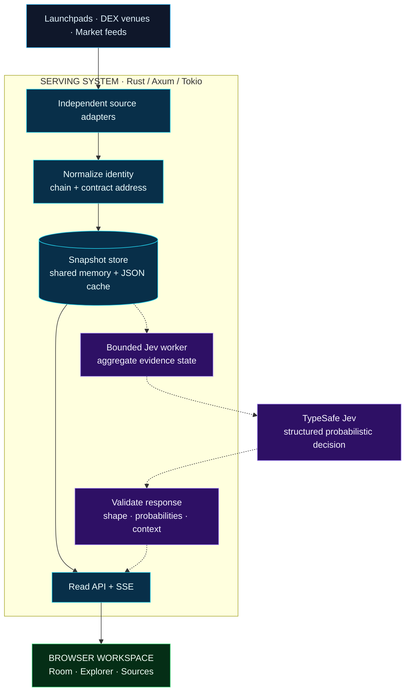
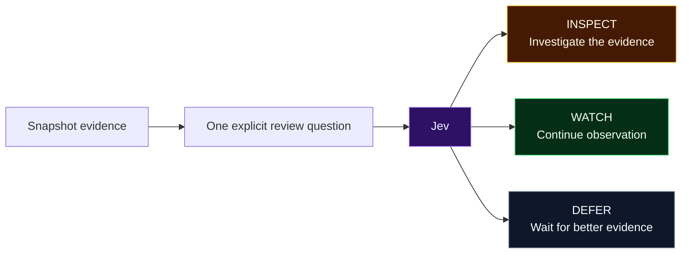

<p align="center">
  
</p>
<h1 align="center">CrawlCA</h1>
<p align="center"><strong>Many chains. One web.</strong></p>
<p align="center">Contract address intelligence for fragmented on-chain markets.</p>

<p align="center">
  <a href="https://www.crawlca.dev/">Enter the Room</a> ·
  <a href="https://www.crawlca.dev/console.html">Explore contracts</a> ·
  <a href="https://www.crawlca.dev/sources.html">Trace sources</a> ·
  <a href="https://www.crawlca.dev/technology.html">Technical atlas</a>
</p>

<p align="center">
  
  
  
  
  
  
</p>

---

CrawlCA brings launchpad discoveries, DEX observations and market feeds into one inspectable workspace. Each record carries **chain + address**, **source**, **time** and **freshness**. A separate Jev review path gives collection evidence a defined next step: **inspect**, **watch** or **defer**.

| OBSERVE | RESOLVE | INTERPRET |
| :--- | :--- | :--- |
| Collect across independent source adapters. | Connect observations around chain and contract address. | Review collection quality through a bounded decision interface. |

> **Repository scope** — This repository contains the browser workspace and architecture documentation. The Rust collector, API, snapshot store and Jev worker are described components of the serving system; their backend source is not included here. Stack badges describe the product architecture, not a complete backend distribution.

## Technology stack

**A spatial interface. An asynchronous core. Evidence throughout.**

| Layer | Technology | Responsibility | Scope |
| :--- | :--- | :--- | :--- |
| **Browser workspace** | HTML · CSS · JavaScript | Search, filters, inspectors and source diagnostics | Included |
| **Spatial interface** | Three.js · WebGL | Swarm Room rendering and interactive scene | Included |
| **3D assets & controls** | GLTFLoader · GLB · OrbitControls | Room model loading and camera navigation | Included |
| **Browser persistence** | localStorage | Watchlist entries and last-known observations | Included; browser-local |
| **Transport** | HTTP / JSON · Server-Sent Events | Snapshot reads, collection events and polling fallback | Browser client included |
| **Serving layer** | Rust · Axum · Tokio | Read APIs, asynchronous collection and orchestration | Backend architecture |
| **Snapshot state** | Shared memory · JSON cache | Current observations and retained source checkpoints | Backend architecture |
| **Decision interface** | TypeSafe Jev · System One | Collection-level review: inspect, watch, defer | External model + backend worker |

[Explore the technical atlas →](https://www.crawlca.dev/technology.html)

## System architecture

**One evidence foundation. Two independent paths.**



**Solid path:** collect, normalize, store, serve. **Dashed path:** asynchronous review of completed evidence. Browsing and filtering read stored state; they do not trigger a new model call.

[Open the interactive architecture →](https://www.crawlca.dev/assets/diagrams/crawlca-architecture.html) · [View its source](assets/diagrams/crawlca-architecture.html)

## Jev · the decision layer

**Evidence in. Defined outcomes out.**

The documented integration applies [TypeSafe Jev](https://typesafe.ai/blog/introducing-system-one-models-and-jev) to the quality of an entire collection snapshot. Its input is a compact evidence summary, rather than a token-by-token investment dossier.

| Evidence | What the worker supplies |
| :--- | :--- |
| **Availability** | Source health, successful and failed adapters, cached states |
| **Freshness** | Snapshot and observation times; live, cached, stale and unverified counts |
| **Coverage** | Present and missing market cap, valuation, liquidity, volume, holders and creation time |
| **Scope** | Record counts, unassessed risk flags and provenance limitations |



Before presentation, the response passes three application checks:

1. **Contract shape** — accepted model identifier, typed choice and supported route.
2. **Probability integrity** — finite values within `[0, 1]`, a distribution summing to one within tolerance, and a highest-probability selected route.
3. **Context binding** — model identity, snapshot time, evaluation time, record count and review scope remain attached.

`GET /api/jev` reads the latest review status; it does not initiate inference. The UI can retain an earlier validated result with its timestamps, or show a neutral waiting state. A displayed probability describes the selected review route, not token safety or future returns. Response validation checks structure and consistency, not the correctness of the model's judgment.

[Read the Jev integration design →](https://www.crawlca.dev/technology.html#jev) · [TypeSafe choice documentation](https://docs.typesafe.ai/primitives/choice)

## Three clocks. One workspace.

| Collection | Review | Presentation |
| :--- | :--- | :--- |
| **Request → Normalize → Commit** | **Eligible snapshot → Evaluate → Validate** | **Read → Render → Inspect** |
| Each source keeps its own last-success checkpoint. | New evidence and the review interval gate attempts; one review runs at a time. | Browser reads and scene animations remain independent of inference. |

Source failures are isolated. Bounded requests and retained snapshots preserve context through upstream delays. The model call runs without holding the source-cache lock. **An older observation retains its original time; a refreshed screen does not make it new.**

## Surfaces

| | | |
|---|---|---|
| **Room** | [`room.html`](room.html) | A spatial view of sources, contract snapshots, and collection activity. |
| **Explorer** | [`console.html`](console.html) | Search, filter, and inspect contracts. A watchlist stays in this browser. |
| **Sources** | [`sources.html`](sources.html) | Collection health, request events, and the snapshot behind each feed. |
| **Technology** | [`technology.html`](technology.html) | The atlas: architecture, provenance, and the Jev decision layer. |

Open the interactive map at [`assets/diagrams/crawlca-architecture.html`](assets/diagrams/crawlca-architecture.html).


## Multichain source coverage

Independent adapters follow each source’s own interface and cadence.

| Chain | Sources |
|---|---|
| Solana | Pump.fun, Moonshot, Raydium, Meteora |
| BNB | Four.meme, Flap.sh |
| Base | Aerodrome |
| Ethereum | Uniswap |
| Robinhood | Robinhood launchpad, Robinhood Uniswap, GMGN partner |
| Multi | GMGN official |

Identity is the chain plus the contract address. Symbols, names, and logos describe that identity. They do not define it.

### Evidence travels with the record

| Field | What it carries |
|---|---|
| `identity` | Chain and contract address |
| `observation` | The metrics and metadata the source actually returned |
| `provenance` | Adapter, route, and collection time |
| `freshness` | `live` · `cached` · `stale` · `unverified` |

Unknown market fields stay unknown. Explorer loads up to 500 records from sampled feeds. Activity scores come from market rules. A provider warning is shown as flagged. An unassessed row has no verified assessment on file.


## This repository

This tree is the browser workspace: static pages, the Room scene, and the architecture diagram. The Rust service is the product’s serving layer, described above. It is not included here.

```
room.html                 Room
console.html              Explorer
sources.html              Sources
technology.html           Technology
index.html                Local entry, forwards to Sources
assets/brand/             Mark and favicon
assets/diagrams/          Interactive architecture
assets/mission-room.glb   Room model
assets/logos/             Venue marks
vendor/                   Three.js, GLTFLoader, OrbitControls
```

On localhost the pages call `http://127.0.0.1:8788/api`. Add `?api=PORT` to point at another local port. Set `window.CRAWLCA_API` before the page scripts to use a specific base URL. Anywhere else, the pages call the relative path `/api`.

Serve the folder with any static server, then open `room.html`.

```bash
python3 -m http.server 4173
```

The static server previews the browser workspace only. Live collection and Jev review require the separate backend. Collection runs on that server; refreshing a page reads its latest snapshot.

## Principles

**Identity is explicit.** The same ticker can name different assets. Context starts with the chain and the address.

**Time is part of the data.** A retained observation stays useful because its freshness stays visible.

**Uncertainty stays visible.** Unknown fields remain unknown. Review begins where the evidence ends.

## Design horizon

The technical atlas outlines three directions for further development:

- **Richer relationships** — connect contracts, venues and source events into navigable market context.
- **Adaptive review** — refine inspection priorities as coverage and conditions evolve.
- **Composable intelligence** — extend structured context into broader research and monitoring workflows.

These are design directions, not delivery commitments. See the [current technical atlas](https://www.crawlca.dev/technology.html#horizon).

---

<p align="center"><strong>Tiny spider. Wider view.</strong><br>Identity is explicit. Time is part of the data. Uncertainty stays visible.</p>
